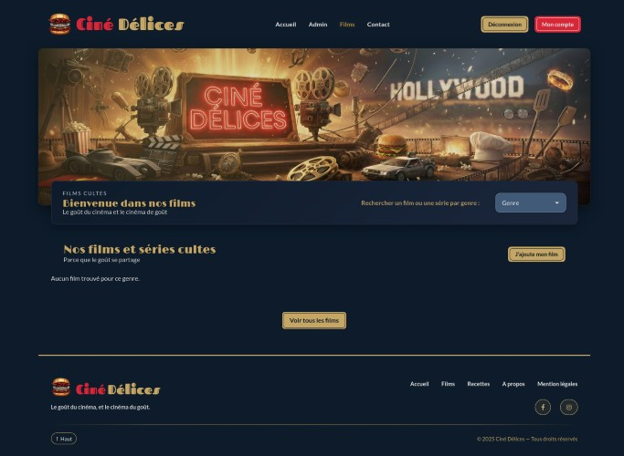
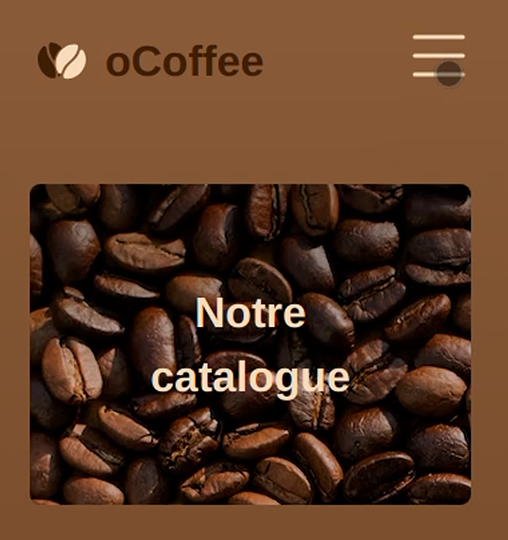
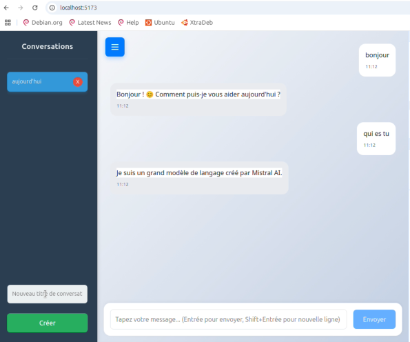

#

## Salut! 👋

Je suis **Ludovic**, développeur web et mobile français. Je suis toujours avide d'apprendre et de collaborer avec les autres pour créer des solutions efficaces.

## A propos de moi    

Après 23 ans dans l'industrie automobile, j'ai choisi de me reconvertir en développement web pour donner une nouvelle orientation à ma carrière. Formé chez O'clock, j'ai acquis de solides compétences en HTML, CSS, JavaScript, Node.js et Git. Curieux, rigoureux et orienté solutions.

[contactez moi](#Contactez-moi) 

[Ma page perso](https://trichereauludovic.github.io/)  

## Compétences et technologies 

  
  
  
  
  
  
  

## Meilleurs projets

| link  | repo name | description |
| ------ | ------| ------|
|Projet en cours...  | Stage |  Création d'un site e-commerce professionnel pour une cliente. |
|  | portefolio |  Une simple landing page personnelle en html5/ css3 et javascript. [Ma page perso](https://trichereauludovic.github.io/) |
| | Cinedelices | Projet de fin de formation réaliser en groupe. Ce projet avait pour sujet: les recettes vue dans les films et les séries cultes. Nous l'avons créé de bout en bout. le site a été réaliser en monolythique ( nodeJs, express, ejs, javascript, postgresQL, jwt et argon2 pour la sécurisation, multer et sharp pour l'upload et le traitement des images entre autre)  |
|  | O'coffee |  il s’agit d’un catalogue de cafées à des fins informatives uniquement, mais pas d’un site e-commerce, avec une base de données postgresql. |
| | O'chat | Ce projet permet de mettre en application les compétences de développeur front-end en réalisant une interface utilisateur permettant d'interagir avec l'API du LLM Mistral. |

## Statistiques GitHub

 

## Activité récente

Je n'ai actuellement aucune activité enregistrée sur GitHub, mais j'ai hâte de m'engager davantage avec la communauté !

## Contactez moi

 

---

 
 

